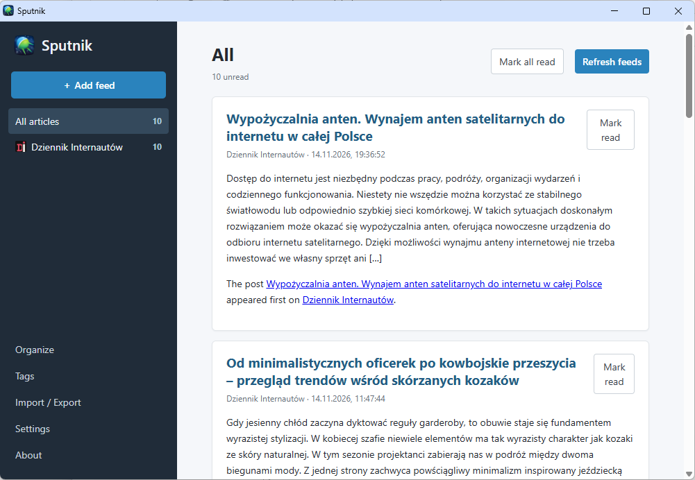

# Sputnik

Sputnik to czytnik kanałów RSS i Atom, którego historia zaczęła się w 2013 roku.
To repozytorium jest eksperymentalną, rozwijaną współcześnie wersją projektu
sprzed około 13 lat — nie jest oficjalnym wydaniem ani obietnicą pełnej zgodności
z oryginałem. Celem jest sprawdzenie, czy klasyczną aplikację desktopową można
bezpiecznie i sensownie ożywić, stopniowo ją modernizując.

Projekt jest we wczesnej fazie rozwoju. Mogą występować błędy, a kierunek dalszych
prac może się zmieniać na podstawie testów i opinii użytkowników.

## Zrzut ekranu



## Co już działa

- Czytanie kanałów RSS i Atom oraz pobieranie artykułów.
- Dodawanie i organizowanie kanałów, kategorie, tagi i oznaczanie przeczytanych
  artykułów.
- Import i eksport subskrypcji OPML.
- Oczyszczanie niezaufanej treści artykułów przed wyświetleniem.
- Przenośna wersja Windows z dołączonym runtime’em — do uruchomienia nie trzeba
  instalować Node.js.

Sputnik nie wysyła telemetrii ani nie sprawdza automatycznie aktualizacji.
Kanały i obrazy są pobierane z adresów używanych przez aplikację. Aplikacja
korzysta z NW.js i Preact.

## Plan rozwoju

To wstępny plan, a nie zobowiązanie do konkretnych terminów. Priorytetem jest
stabilność i prywatność; większe funkcje, takie jak AI i aplikacja mobilna, będą
uzależnione od opinii użytkowników i wykonalności.

1. **Stabilizacja wersji desktopowej**
   - Naprawianie błędów dodawania i odświeżania kanałów.
   - Rozbudowa testów regresji oraz sprawdzanie typowych formatów RSS i Atom.
   - Poprawa komunikatów błędów, dostępności i obsługi długich lub uszkodzonych
     kanałów.
2. **Wygoda i niezawodność**
   - Lepsza nawigacja, wyszukiwanie i filtrowanie artykułów.
   - Kopie zapasowe, odtwarzanie danych oraz dopracowanie importu i eksportu.
   - Uproszczenie procesu aktualizacji i przygotowania wydań.
3. **Podsumowania artykułów z użyciem AI — eksperymentalnie**
   - Najpierw prototyp i ocena jakości oraz kosztów.
   - Funkcja będzie opcjonalna i wyłączona domyślnie.
   - Przed wdrożeniem zostanie jasno określone, czy treść jest przetwarzana
     lokalnie, czy wysyłana do zewnętrznej usługi; wysyłanie danych bez zgody
     użytkownika nie jest założeniem projektu.
4. **Eksploracja aplikacji mobilnej**
   - Sprawdzenie możliwości współdzielenia logiki z wersją desktopową.
   - Projekt mobilnego interfejsu i wybór technologii dopiero po prototypie.
   - Synchronizacja między urządzeniami wymagałaby osobnej decyzji o architekturze,
     bezpieczeństwie i ewentualnym serwerze — nie jest jeszcze dostępna.

## Uruchomienie wersji przenośnej Windows

Otwórz `release/windows/Sputnik.exe` i pozostaw obok niego cały folder
`release/windows`. Program korzysta z dołączonych plików NW.js, więc użytkownik
nie musi instalować Node.js ani uruchamiać instalatora.

## Budowanie i testy

Do budowania potrzebny jest Windows, Node.js 22 lub nowszy oraz NSIS. Z katalogu
głównego repozytorium:

```text
cd app
npm ci
npm test
npm run build:windows
```

Wynikiem jest przenośna aplikacja w `release/windows/` oraz instalator
`release/windows/Sputnik-x64-Setup.exe`. Workflow GitHub Actions potrafi zbudować
instalator ręcznie lub dla tagu `v*`.

## Licencja

Oryginalny Sputnik deklaruje licencję GNU GPL v3 lub nowszą. Autorem pierwotnego
projektu jest Jakub Szwacz; zachowaj informacje o autorstwie i licencji przy
dalszym rozpowszechnianiu.
